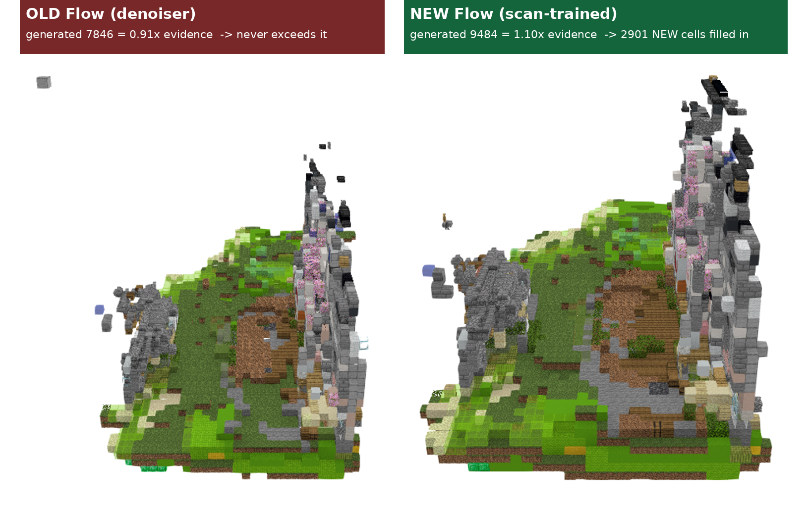
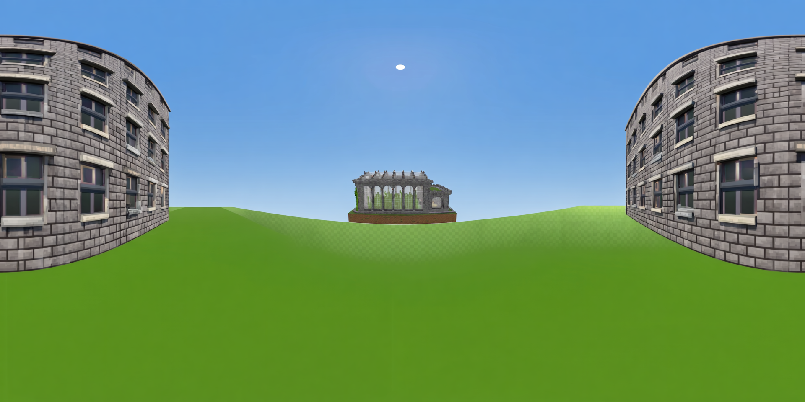
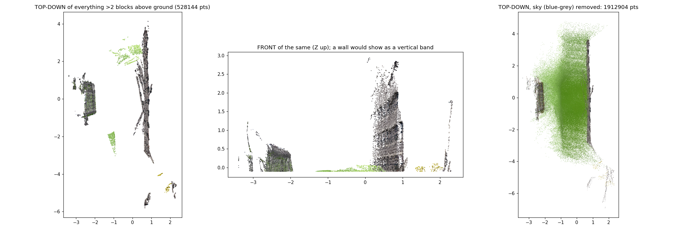
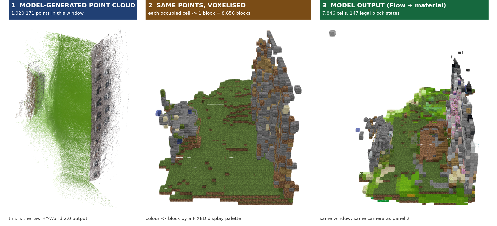
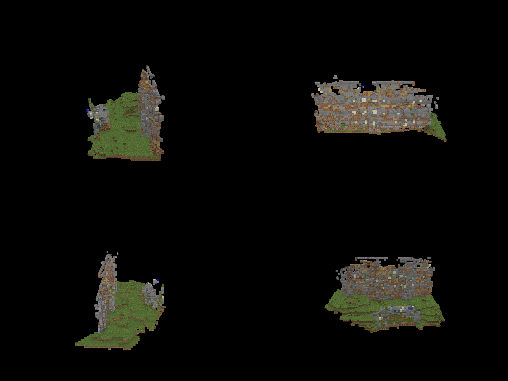
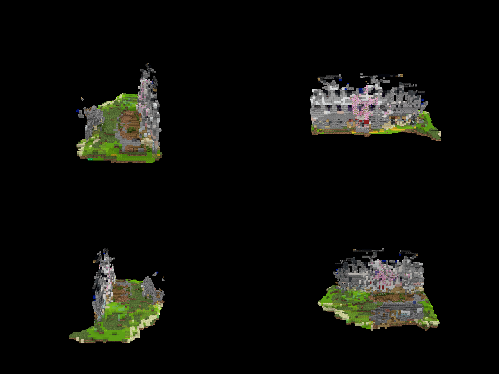

# Building-generation

**从纯文字 prompt 生成 Minecraft 建筑** —— 文字 → HY-World 2.0 世界点云 → Minecraft 方块（合法 1.21.4 blockstate）→ litematic。

当前主线是 **v6**：把 HY-World 2.0 生成的点云真正变成可导入游戏的建筑。历史版本见文末。

---

## 成果

### 1. 补体训练：模型从「去噪器」变成「补全器」

同一场景、同一相机，左＝旧模型，右＝新模型（v6 的 scan-evidence 训练）：



- 旧模型**永远输出 ≤ 证据**（6 组实验的 生成/证据 都在 0.79–0.92）
- 新模型 **生成/证据 = 1.096**，凭空补出 **2,901 格（占生成量 30.6%）**
- 连通块团从 **17 个降到 14 个**：新增格子贴在已有结构上，不产生零星碎块

### 2. 生成的点云里确实有建筑

左：种子全景（HY-Pano 出的地面视角方块全景，两侧是建筑外墙）。右：生成点云的"站立高度检验"。





- 新场景：高出地面 **>5 方块有 301,071 点**、**>8 方块有 118,820 点**，天空只占 4.4%
- 修复前的风景场景：高出地面 >5 方块 **= 0**，天空占 46%

### 3. 点云 / 体素化 / 模型输出 三者的关系

同一个 64³ 窗口、同一视角、三种形态：



① 模型生成的点云（192 万点）→ ② 同一批点体素化（每格一方块，8,656 格）→ ③ 模型输出（结构 Flow + 材质，147 种合法 blockstate）。
② 只是 ① 的显示方式（无模型参与），③ 才是模型对点云的重新预测。

### 4. 点云体素化后经真渲染器出图



灰色石砖墙体上有规则的浅色窗格，立在绿色草地地形上——**这就是点云里的建筑立面**。

### 5. 模型输出（新 flow）



---

## v6 结论

冻结 64 建筑基准、**同一份挖空证据**上的配对比较：

| | 旧 flow | 新 flow（scan 训练） |
|---|---|---|
| occupancy IoU | 0.4626 ± 0.0175 | **0.4818 ± 0.0166** |
| 配对差值 | — | **+0.0192 ± 0.0046 → "scan_v1 better"** |
| recall | — | **+0.0277 ± 0.0075 → "better"** |
| precision | — | +0.0049 ± 0.0056 → 无差别（没变差） |
| 原始证据基线 | 0.4004 ± 0.0121 | （两个模型都超过它） |
| 部署时 生成/证据 | 0.79–0.92（从不 >1） | **1.096** |

**提升全部来自 recall**——补得更多但没多塞垃圾。

## v6 做法

**1) 造「外表面证据 → 实体建筑」训练对**（`v6/code/build_scan_evidence_dataset.py`，11,643 栋）

```
outside = 从体边界出发、不穿实体可达的空气（6 连通 flood fill）
shell   = 与 outside 六邻接的实体格        ← 从外面看得见的表面
visible = shell 膨胀 1 格
证据    = 原 counts/colours，只保留 visible 的格
目标    = 原 labels，一格未动
```

砍掉内部泄漏 **5,018,321 格（18.54%）**。闭集监督证明由仓库自己的 `audit_source` 重签——它只校验「目标 = 源 schematic 裁剪」与「裁剪外无非空气」，**从不检查证据**，所以"改证据、不改目标"是合规的，**没有伪造任何证明**。

**2) 重训**：热启动旧最佳 + cosine LR + EMA，5 小时 / 33,000 步。

**3) 部署链路**（`v6/code/hyworld2_cloud_infer.py`）

```
点云 PLY → 非度量尺度契约 → 逐格池化 → 结构 Flow → 材质 → litematic → render.mjs 渲染 → 看图
```

尺度是**选**的（`blocks_per_unit = 8`，HY-World 单位没有物理尺寸）；轴向映射 Z-up→Y-up，行列式 +1（是旋转不是镜像）。

## 仍未做到（不粉饰）

1. **补体幅度有限**：证据砍 18.5%，部署净增约 10%（补 2,901、漏 2,073）；基准上 `generated_cells` 与旧模型无差别——它主要是**把格子放得更准**，不是大幅增体。
2. **材质模型未重训**：仍是旧证据分布上的 checkpoint，而结构已换分布。
3. **点云本质仍是壳**：摄影测量式重建只看得见表面。
4. 天空用蓝灰启发式过滤（占 4%），不是模型分割。
5. 尺度/裁窗只试了少数几组；`sde_noise` 未启用（基准显示有 +0.0184 的潜力）。

## 目录

| 路径 | 内容 |
|---|---|
| `v6/` | **当前主线**：HY-World 2.0 点云 → 建筑（详见 `v6/README.md`） |
| `v6/code/` | 部署驱动、scan-evidence 语料构建器、证明重签、11 个 HY-World 2.0 修复补丁 |
| `v6/work/` | 报告 + 证据（配对判定 JSON、对比图、生成的 litematic） |
| `v5/` | mcfix 修复管线（`REPAIR_REPORT.md` / `RUNBOOK.md`） |
| `v4/` | inpaint 管线（`ARCHITECTURE.md`） |
| `inpaint_upgrade_codex/` | inpaint 升级代码 |
| `schem_render/` | litematic 渲染器（Node + 原版资源包） |
| `TRELLIS/` | TRELLIS 模型代码 |
| `PROJECT_MAP.md` | 历史/基线资产地图 |
