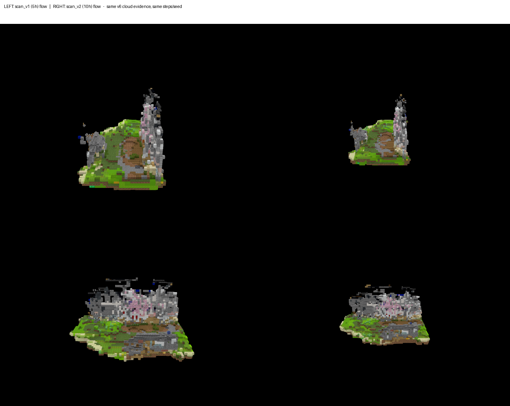
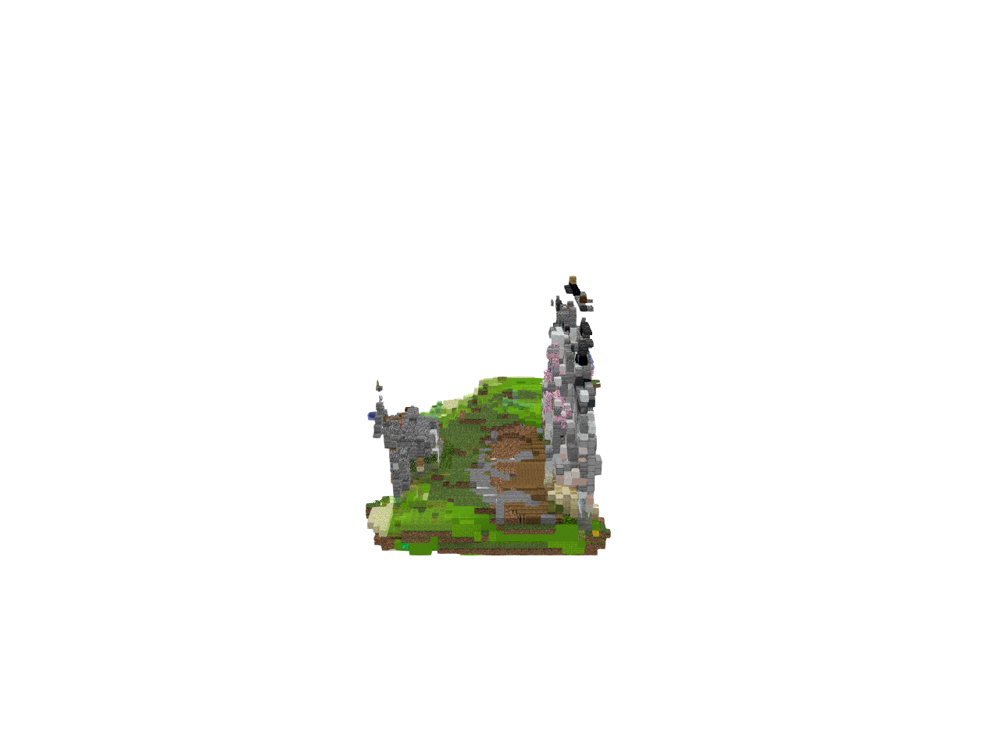
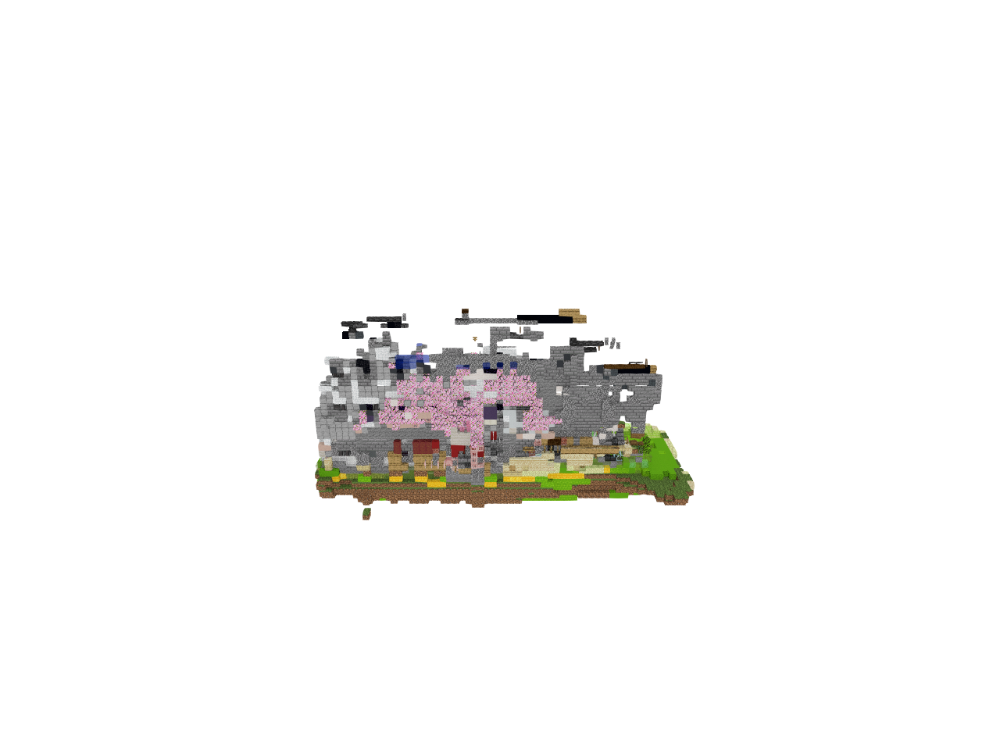
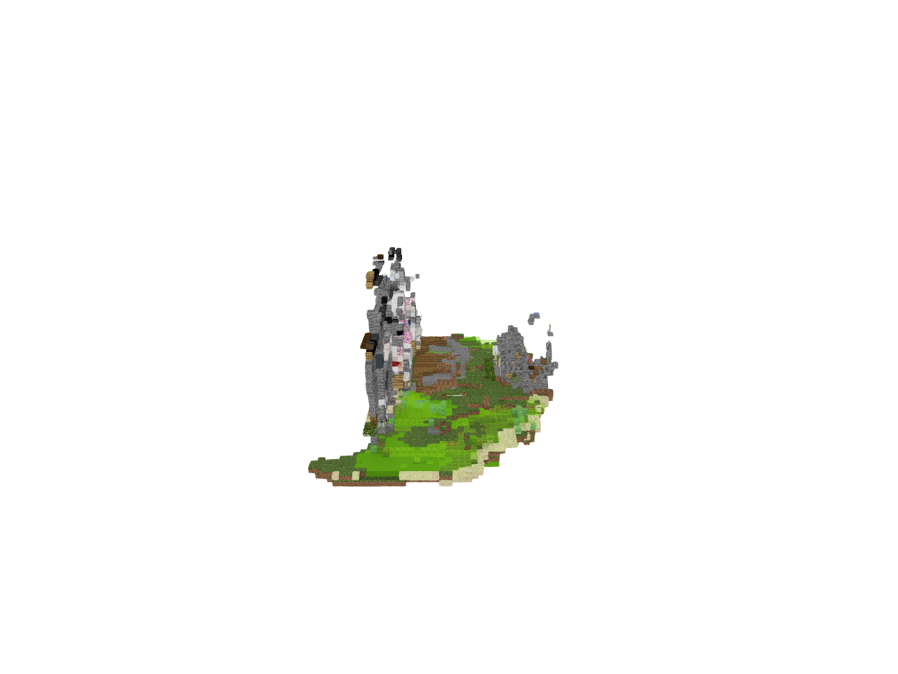
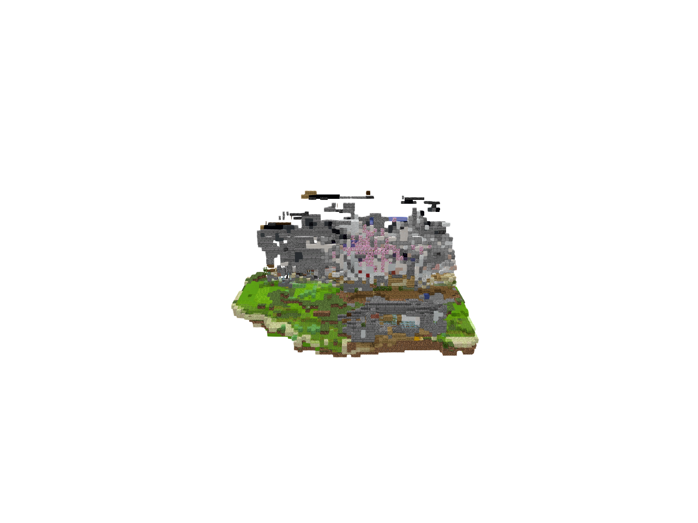
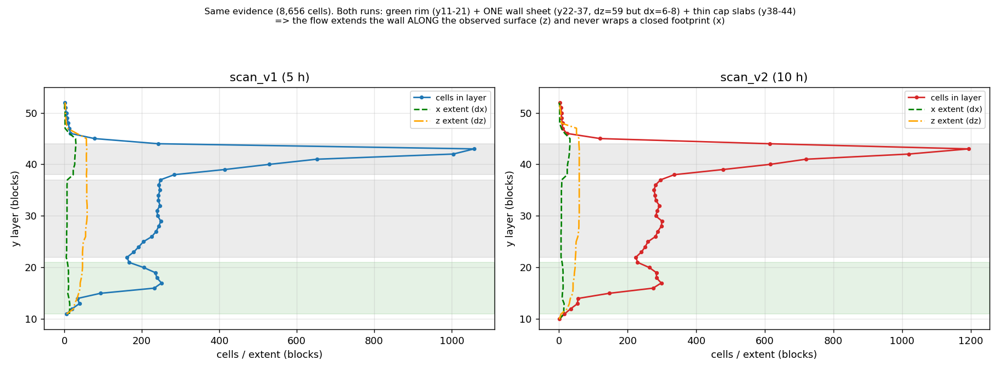

# v8 — 结论：**仍然未达标**（视觉检查否决）

> 验收顺序（从 v7 起固定）：**先看图 → 图不合格就直接判不合格 → 指标只用来解释原因，不许翻案。**
> 本文件里所有数字都是**诊断**，不是合格依据。

任务目标：从 HY-World 2.0 生成的点云里，输出**一栋完整的建筑外表面**（不是内部房间、不是一面墙）。

本轮做了什么：把 scan-evidence 语料上的结构 Flow **再训 10 小时**（34,000 步，cosine，从 scan_v1 的 33,102 步热启），然后在**同一个点云、同一份证据、同样的步数/种子**上重新部署，和上一版逐图对比。

---

## 一、看了图：和上一版**没有本质区别**

左 = scan_v1（5 h），右 = scan_v2（10 h）——同一输入、同一流程、只是模型换了：



四个视角（scan_v2）：






图上是什么：**一片绿色地面边缘 + 一整面灰色薄墙 + 墙上一个粉色团（樱花色羊毛）+ 墙顶几根悬空黑色薄板 + 一根细尖塔**。
没有闭合的墙体、没有屋顶、没有"一栋楼"的体量。**和 v1 是同一个东西**，只是略微变厚。

## 二、体量剖面：说明它为什么不是"一栋楼"



把 64³ 体素逐层拆开（`y` 为层，`cells` 为该层格子数，`dx/dz` 为水平跨度）：

| y 层 | 是什么 | v1 | v2 |
|---|---|---|---|
| 11–21 | 绿色地面**薄边**（1–2 格厚，填满率 0.06–0.56） | 6,239 格（含全部） | — |
| 22–37 | **一整面墙**：`dz` 一路涨到 59（整个裁剪长度），但 `dx` 只有 6–8 | 每层 162–248 格 | 每层 224–300 格，填满率 +0.1 |
| 38–44 | 墙顶**薄板**：`dx` 突然涨到 30，填满率 0.22–0.65，只有 3–7 层厚 | 1,004–1,058 格/层 | 1,019–1,194 格/层 |
| 45–52 | 细尖塔：`dx=1–2` | 40 格 | 42 格 |

关键一行：**在墙的那 16 层里 `dz=59`（沿观测面方向铺满），`dx` 只有 6–8（垂直于观测面方向不展开）。**
也就是说 Flow 学到的是"**把看到的那面墙沿着墙面自己延伸**"，**不是**"围出一个闭合的建筑轮廓"。

连通性上没有碎块问题：v1 14 个连通块 / 最大块占 99.1%，v2 13 个 / 99.3%（6-连通）。v6 那轮的"消除零星方块"是真的，这一轮也没退化。

## 三、数字（仅作诊断，不作为合格依据）

| 指标 | scan_v1（5 h） | scan_v2（10 h） | 变化 |
|---|---|---|---|
| 生成 / 证据 格数 | 9,484 / 8,656 = **1.096** | 11,517 / 8,656 = **1.331** | +2,033 格（+21%） |
| 导出尺寸 (x,y,z) | 42×31×59 | 43×33×59 | 各 +1 / +2 / 0 |
| 验证集 flow IoU | 0.4466 | 0.4488 | **+0.0022（噪声级）** |
| 最佳 val IoU | 0.5094 | 0.4993 | **−0.0101** |
| 训练 mse（尾段） | — | 0.4797 | 平 |
| 材质状态种类 | 150 | 149 | 平 |

**读法**：多出来的 21% 格子全部落在"同一面墙 + 同一片地面边"上（见上表每层 +40~60 格），
验证集 IoU 只动了 0.002、最佳 val 反而更低。**多训的 5 小时买到的只是"同一堵墙更厚一点"。**

## 四、根因

### 4.1 模型侧（有把握的部分）：训练目标只有"闭合表面 → 实心体"

训练语料的输入证据，定义在 `tools/cloudbuild/build_scan_evidence_dataset.py`：

```python
outside = ndimage.binary_propagation(seed, mask=air)   # 从体积边界能走到的空气
shell   = solid & ndimage.binary_dilation(outside)     # 与外部空气 6-邻接的实心格
visible = ndimage.binary_dilation(shell, iterations=dilate)  # 默认 1
```

`shell` 的定义是"**所有与外部空气相邻的实心格**"——**那就是一栋楼完整的、四面闭合的外表面**。
所以训练时模型面对的永远是 **输入 = 完整闭合外表面 → 输出 = 该实心体**，
它只学会了"把已经闭合的表面变成实心体"（shell → solid）；
而部署时输入是**局部观测**（8,656 / 262,144 = 3.3% 覆盖）。
"**从一张开口的局部表面补出一个闭合外表面**"这件事，语料从来没要求过它做。

这解释了为什么再训也同一个东西：两轮训练**任务定义相同**，多出来的格子只是同一面墙变厚。

### 4.2 数据侧（v7）：**我上一版写的根因是错的，这里更正**

我在 v7 结论里写过"`--move_dist 12` 让相机飞出去 76 单位、掠过了建筑"。**这是错的**，
我在服务器上把 v7 的真实相机位姿全量量了一遍（`gs_data/cameras.json`，598 帧 / 33 条轨迹）：

| 量 | 实测 |
|---|---|
| 每条轨迹的路径长度 | 中位数 **0.74** 单位，最大 **5.11** 单位 |
| 相机到房子中心的距离 | 最小 3.17 / 中位 **4.02** / 最大 6.36 单位 |
| 房子中心（`target_camera.json`） | `[-3.41, -0.17, 2.12]`，`scale_3d = 4.08` 单位 |

`move_dist` 是 `process_trajectories(..., D, ...)` 里的 **D = 路径长度上限（超过才截断）**，
`D = move_dist × median_depth × 1.5 = 12 × 4.24 × 1.5 ≈ 76`——**实际轨迹最长只有 5.11，根本没触发截断**。
所以 `move_dist` 在 v7 里**完全没有起作用**，把它改成 1.0 也不会改变任何东西。
（我另外把"建筑在 30 单位外"当成了 HY-World 世界单位——那其实是我合成全景时**16 方块制**的取景距离，
换到 HY-World 世界单位里房子离相机只有 4.02 单位。**两个单位混用了，这是我的错误。**）

那 v7 真正发生了什么？把三段链路逐段量出来：

1. **全景 / 轨迹帧是对的**：`render_results/*/traj0/render.mp4` 里房子又大又完整（含雪白屋顶）——
   见 `scanv2_deploy/v7_frames_vs_output.png`，左列是渲染输入，右边两列是 WorldStereo 的输出，都很清楚。
2. **逐帧点云 `global_pcd.ply` 也有屋顶**：房子附近 z>3.2 有 **14,836** 点，其中雪白（低饱和高亮）**3,255** 点，最高到 z=5.48。
3. **融合后的 `aligned_pcd.ply` 把屋顶丢了**：同一区域 z>3.2 只剩 **3,070** 点、雪白仅 **319** 点，最高 z=4.80。

按房子中心统计方位覆盖（24 扇区）：

| 高度带 | v7 aligned | v7 global |
|---|---|---|
| 下段墙 z0.3–1.5 | 299,712 点，**23/24 扇区** | 33,627 点，17/24 |
| 中段墙 z1.5–2.5 | 104,691 点，17/24 | 20,423 点，17/24 |
| 上段墙 z2.5–3.5 | 29,702 点，17/24 | 21,437 点，17/24 |
| **屋顶带 z3.5–5.6** | **1,559 点，7/24** | 11,096 点，10/24 |

**结论（数据侧）**：墙的低段四面都在（23/24），**越往上越稀，屋顶基本没了**。
而且我在 v7 里**把 `--apply_up_route` 删掉了**（v6 有，v7 没有——我当时的理由是"相机保持水平、拍立面不拍屋顶"），
于是**没有任何一条轨迹从上方看过屋顶**；pano 相机也站在地面高度（eye 高度 3 方块 vs 房高 22 方块），
屋顶在全景里几乎是**侧着的一条线**，深度最不可靠。
屋顶从"没人从上面看"+"全景里侧着看"两处同时失守，融合阶段把它当噪声丢掉了。

> 这是**假设**（机制来自代码 + 分段测量），不是结论。检验方式见下节——**看图之前不许当结论用**。

## 五、下一步（按性价比排序，都还没做）

1. **数据侧 v8：把 `--apply_up_route` 加回来**（v6 有、v7 被我删了），其余完全不动（pano 不变、`move_dist` 不变，
   因为实测它根本没起作用）。单变量实验。
   检验方式（可证伪）：重跑 stage 1–5 后，上表的"屋顶带 z3.5–5.6"必须从 1,559 点/7 扇区显著涨上去；
   涨不上去 → 假设被否，说明丢屋顶是融合本身的机制，要去查 stage 3 的对齐/一致性过滤。
2. **模型侧：遮挡证据语料 + 重训**（已在本地跑，见 `build_occluded_evidence_dataset.py`）
   把训练证据从"完整外表面"改成"单侧相机看得到的表面"，目标不变。
   显存/时间：语料 11,643 栋已建好（**59% 的真实外表面不在证据里**，正是部署要模型自己补的量），
   证明已重签 11,643 份 0 失败，重训已启动。
   检验方式：同一份点云证据重新部署后看图——墙必须开始在 `dx` 方向围合，否则假设被证伪。
3. **材质模型**在 scan / occl 证据分布上重训（结构已换分布，材质还是 `trellis_material_ctx_v1`）。
4. 采样侧还没扫：`sde_noise`、guidance、threshold。
5. v7 的 `--drop-terrain` / `--building-only` 裁剪窗口也要复核：房子中心在 `(-3.41,-0.17)` 而不在原点，
   而裁剪窗口是按原点/场地中心取的（`origin_xyz=[-27,-6,-39]`），房子虽然落在窗口里但不是窗口中心。

## 六、交付物（绝对路径）

- 本次模型输出（成品文件，可直接导入游戏）：`/run/media/sensen/Data1/minecraft/AI_3D_World_Repos/outputs/cloudbuild/hyworld2_deploy_scanv2/scene_scanv2.litematic`
  （副本：`/home/sensen/Desktop/hyworld2_exterior_ref/scanv2_deploy/scene_scanv2.litematic`）
- 渲染图 4 视角：`/run/media/sensen/Data1/minecraft/AI_3D_World_Repos/outputs/cloudbuild/hyworld2_deploy_scanv2/render/`
- 对比图：`/home/sensen/Desktop/hyworld2_exterior_ref/scanv2_deploy/v1_vs_v2_side_by_side.png`
- 剖面图：`/home/sensen/Desktop/hyworld2_exterior_ref/scanv2_deploy/layer_profile_v1_vs_v2.png`
- 上一版（v1）渲染：`/run/media/sensen/Data1/minecraft/AI_3D_World_Repos/outputs/cloudbuild/hyworld2_deploy_scanflow/render/`
- 训练记录：`/run/media/sensen/Data1/minecraft/AI_3D_World_Repos/outputs/cloudbuild/trellis_flow_scan_v2/report.json`

渲染用 `tools/schematic_render_local/render.mjs` + 原版资源包，1280×960，覆盖度检查通过（最小 0.0489）。

## 不声称

- 生成场景**没有 ground truth**，这里没有任何精度/质量分数，所有数字都只是形状描述。
- 方块尺度是**选定的非度量映射**（8 格/单位），不是还原出来的物理尺寸。
- 这条链（点云 → 体素 → 结构 Flow → 材质）是**我们自己搭的实验实现**，不是成品。
- 本轮没有 VLM：caption/标签是手写的，已记录在 manifest 里。
