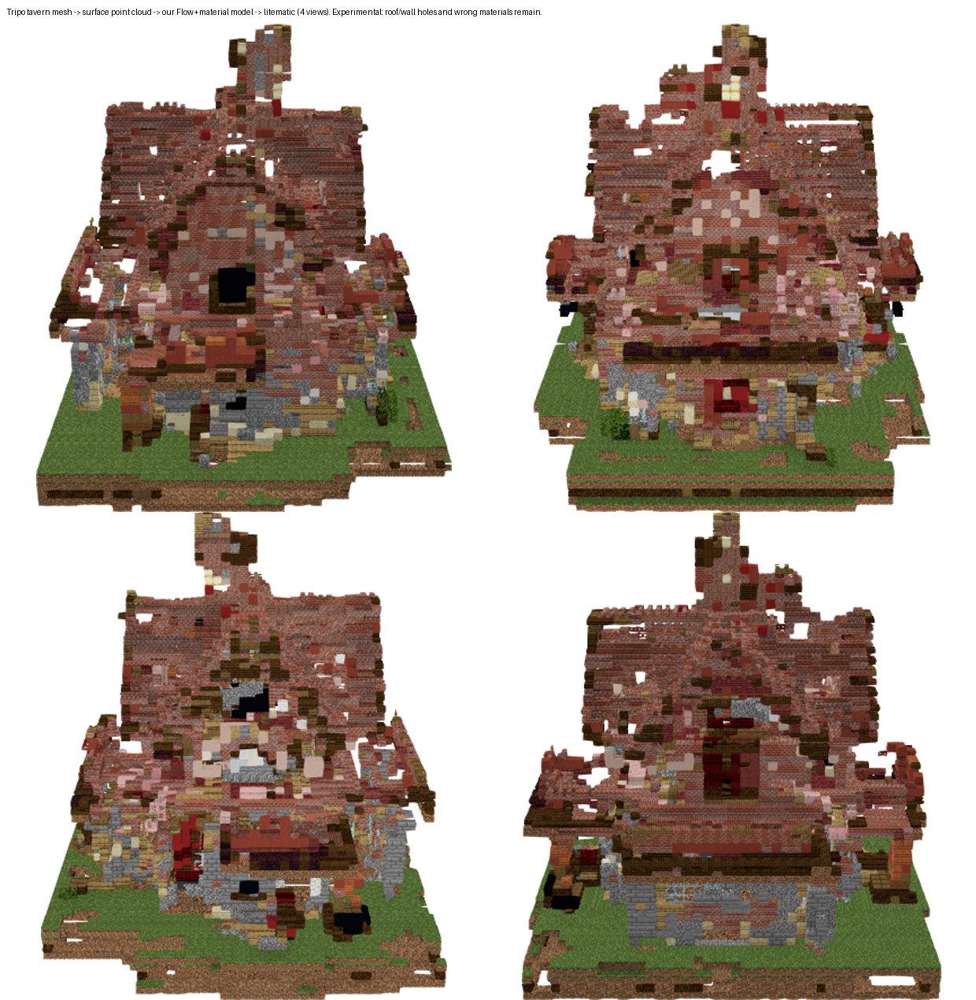
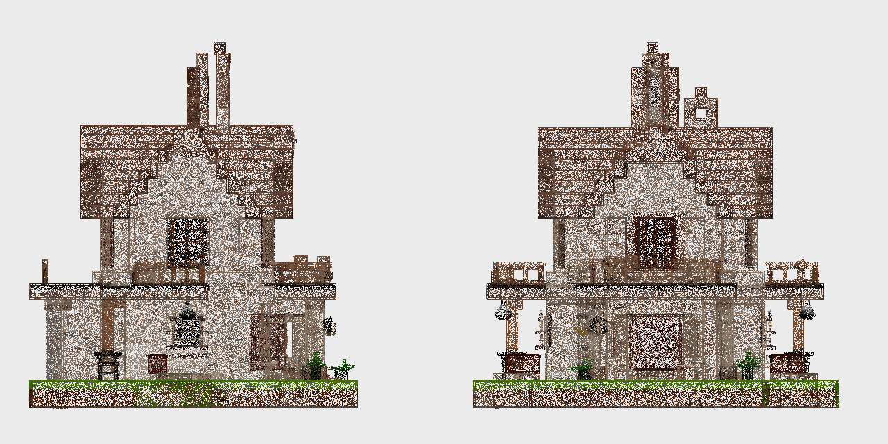
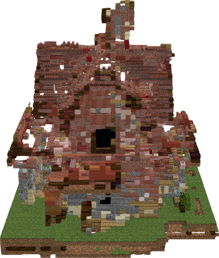
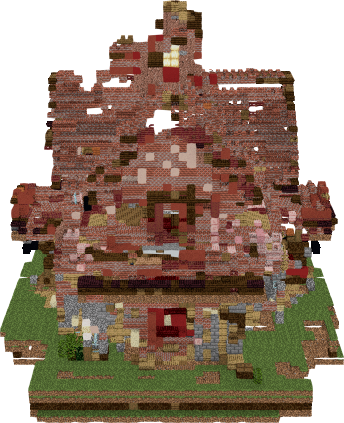
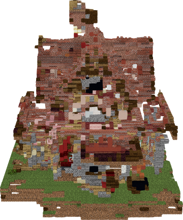
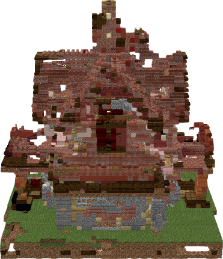

# v9 — 完整网格输入实验（Tripo 酒馆）

> **一句话**：把第三方文生 3D 模型（TripoAI）的酒馆网格采样成彩色点云，喂给本仓库的
> 结构 Flow + 材质模型，**第一次拿到了一栋看得出完整外形的建筑**；
> 但**仍未达标**——屋顶/墙面有破洞、细节丢失、材质明显错乱。



---

## ⚠️ 这轮能说明什么、不能说明什么

**能说明**：本仓库的「点云 → 方块建筑」这一环，在**输入点云覆盖完整外表面**时，
可以产出完整建筑外表面。之前 v6–v8 反复只出一面墙，很可能不是因为下游模型不会造房子。

**不能说明**：

1. **这不是本仓库的文字→世界链路。** 网格是 **TripoAI 的文生 3D 模型**（`type: text_to_model`），
   不是 HY-World 2.0 生成的。所以**不能**据此宣称「纯文字 prompt → 完整建筑」已经打通。
2. **这不是因果对照。** 与 v8 相比，物体、采样方式、尺度、条件输入全都变了，
   无法把改善单独归因于「输入更完整」。
3. **输入比真实扫描更"作弊"。** 采样覆盖**整个网格表面**（含背向、含可能的内部面），
   而 HY-World 是摄影测量式重建，只看得见可见表面。这不是相机可见性模拟，
   也不构成流形/封闭性证明。
4. **无 GT 方块答案**：没有 IoU、没有精度、没有质量分。下面所有数字都是描述性的。

---

## 输入

| 项 | 值 |
|---|---|
| 源文件 | `/home/sensen/Desktop/我的世界中世纪酒馆3d模型_3e2182ec/tripo_pbr_model_1bff69dd-76a9-42f1-b2c1-fd96e47c91f1_meshopt.glb` |
| 原始文件 | 未改动 |
| 压缩 | `EXT_meshopt_compression` + `KHR_mesh_quantization`，用 three.js 自带 MeshoptDecoder 解出 |
| 节点变换 | 单节点，**单位矩阵**（无旋转/缩放/平移） |
| 三角面 | 1,817,210 |
| 基础色贴图 | 4096 × 4096 |
| 采样 | 面积加权，**60 万点**，seed 0，UV 双线性权重插值取色 |
| 采样范围 | 整个网格表面，**含隐藏/内部面**（非光线扫描） |
| 定标 | **等比** 48.91354646 方块 / glTF 单位，最长边 48 方块（**人为选定的非度量尺度**） |
| 体素证据 | 54³ 窗口内 **13,507** 个观测格 |



## 输出

| 项 | 值 |
|---|---|
| 非空气方块 | **11,281** |
| 裁剪后尺寸 | **45 × 48 × 47（XYZ）** |
| palette | 142 种合法 blockstate |
| 导出往返 | **逐格精确通过**（只证明文件正确，不代表效果合格） |
| 模型 | Flow `trellis_flow_occl_xyz_v2/best.pt` + VAE `vae_air_repair_stage4/last.pt` |
| 采样参数 | seed 0、25 步、guidance 1.0、threshold 0.5 |

四视图：

| | |
|---|---|
|  |  |
|  |  |

**保住了**：坡屋顶、烟囱、两层主体、阳台、草地底座 —— 多个方向都能看出建筑体量。
**不合格**：屋顶与墙面破洞、栏杆/窗户细节损失、原深棕木材+石墙被大量红砖与杂色替代。

## 文件

| 路径 | 内容 |
|---|---|
| `work/tripo_tavern_4views.png` | README 用的四视图效果图 |
| `work/tavern_view00*.png` | 单张渲染（原版资源包 + 本仓库 `render.mjs`） |
| `work/input_surface_projections.png` | 输入点云的投影（真实贴图颜色；未填满的稀疏白点为栅格空隙，不是贴图缺陷） |
| `work/tavern.litematic` | **可直接导入游戏**的成品（1.21.4 blockstate） |
| `work/tavern_result.json` | 元数据：尺度、来源边界、采样口径 |

## 复现

```bash
# 1) 解码 meshopt 压缩（不改原文件）
node tools/schematic_render_local/decode_tripo_mesh.mjs \
  /home/sensen/Desktop/我的世界中世纪酒馆3d模型_3e2182ec/tripo_pbr_model_1bff69dd-76a9-42f1-b2c1-fd96e47c91f1_meshopt.glb \
  /home/sensen/Desktop/tripo_tavern_inference/decoded

# 2) 面积加权表面采样 → 彩色点云 + 体素证据
python -m tools.cloudbuild.sample_tripo_surface

# 3) 结构 Flow → 材质 → 导出 litematic
python -m tools.cloudbuild.hyworld2_cloud_infer \
  --ply /home/sensen/Desktop/tripo_tavern_inference/tavern_surface_zup.ply \
  --out /home/sensen/Desktop/tripo_tavern_inference/inference --name tavern \
  --flow .../trellis_flow_occl_xyz_v2/best.pt --vae .../vae_air_repair_stage4/last.pt \
  --device cpu --seed 0 --steps 25 --guidance 1 --threshold .5 --keep-sky \
  --stages flow,material,export

# 4) 原版资源包渲染后看图
node render.mjs --schematic .../tavern.litematic --out .../render --views 4
```

## 下一步（未做）

1. 对照**输入表面直接体素化** vs 模型输出，定位哪些破洞是模型新造的、哪些是输入缺失。
2. 单独检查材质映射（当前大量红砖），确认是材质模型分布问题还是颜色条件问题。
3. 只有在上述定位完成后，才谈重训。
